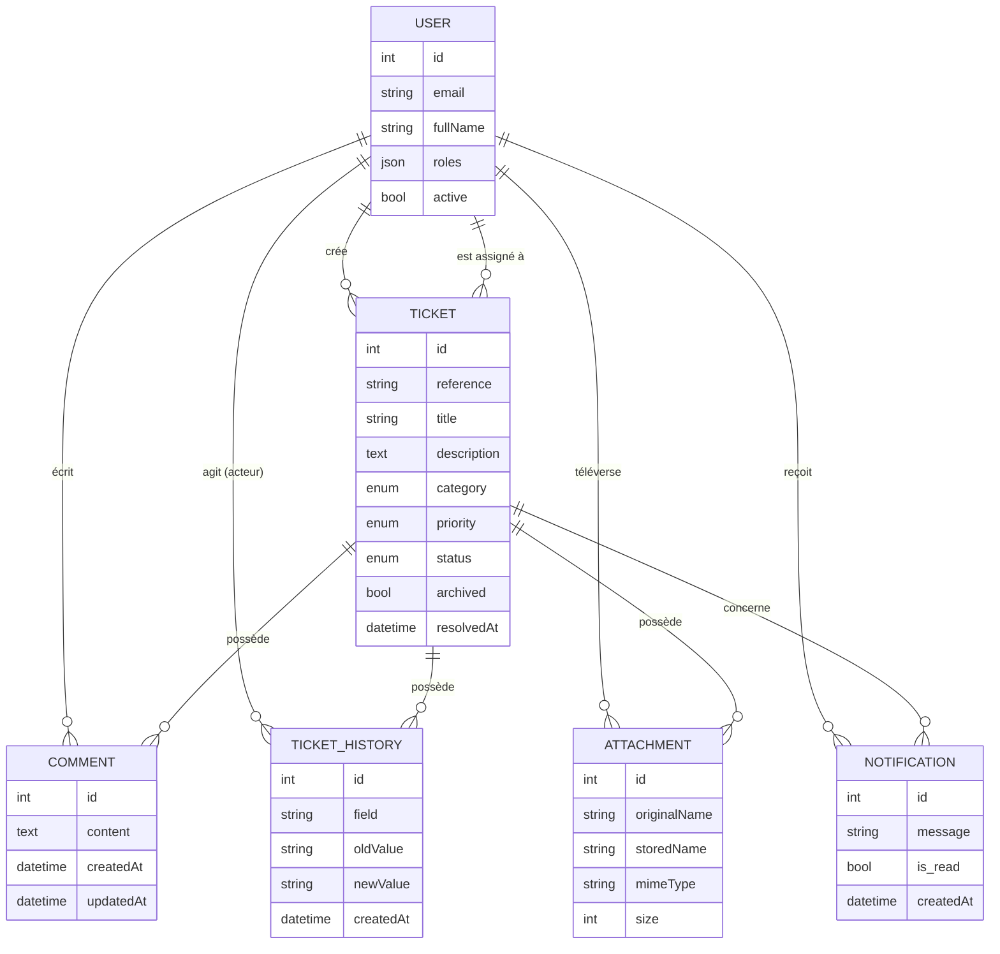

# Architecture de FixFlow

## Vue d'ensemble

```
Navigateur ─▶ React (Vite) ─── /api (proxy) ───▶ Symfony + API Platform ─▶ Doctrine ─▶ PostgreSQL
                                                        │
                                                        └─ Messenger (transport Doctrine) ─▶ worker ─▶ notifications
```

Le frontend ne parle qu'à l'API REST (JSON-LD/Hydra). L'authentification est une **session** Symfony (cookie) : le proxy Vite rend front et API « same-origin », ce qui évite CORS et le stockage d'un jeton dans le navigateur (XSS).

## Organisation du backend (par domaine)

| Dossier | Contenu |
|---|---|
| `User/` | entité `User`, `UserRepository`, `UserProcessor` (rôles, mot de passe) |
| `Ticket/` | `Ticket`, `TicketHistory`, `Attachment`, enums, `TicketProcessor` (règles métier), `TicketAssigner`, `TicketSearchFilter` |
| `Comment/` | `Comment`, `CommentProcessor` |
| `Notification/` | `Notification`, `TicketEvent`, `TicketEventHandler` (asynchrone) |
| `Dashboard/` | statistiques par rôle |
| `Security/` | `TicketVoter`, `VisibilityExtension`, `ActiveUserChecker`, déconnexion JSON |
| `Controller/` | authentification, pièces jointes |
| `Command/` | `app:seed`, `app:tickets:alerts` |

Choix : un découpage **par domaine fonctionnel** plutôt que par type technique ; les entités portent leurs attributs `#[ApiResource]`, la logique métier est dans des **State Processors** (API Platform), pas dans les contrôleurs.

## Modèle de données



Écarts assumés par rapport au descriptif initial :
- **`Role` et `Category` ne sont pas des tables** : trois rôles fixes (`ROLE_ADMIN/DEV/USER`, standard Symfony Security) et des catégories en **enum PHP** (`Category`). Une table ne se justifie que si les catégories deviennent configurables.
- `Ticket.updatedAt` est aussi mis à jour par les commentaires et pièces jointes : c'est ce qui permet de détecter l'**inactivité** réelle.

## Matrice de permissions

| Action | Admin | Développeur | Utilisateur |
|---|---|---|---|
| Voir les incidents | tous | ceux qui lui sont assignés | les siens |
| Créer un incident | ✔ | ✔ | ✔ |
| Modifier titre / description | ✔ | ✘ | ✔ (les siens, non fermés) |
| Changer le statut | ✔ | ✔ (assignés) | ✘ |
| Priorité, catégorie, assignation | ✔ | ✘ | ✘ |
| Archiver / supprimer | ✔ | ✘ | ✘ |
| Commenter | ✔ | ✔ (assignés) | ✔ (les siens) |
| Modifier / supprimer un commentaire | supprimer tous | les siens | les siens |
| Gérer les comptes | ✔ | ✘ | profil uniquement |

Défense en profondeur côté serveur (jamais seulement côté UI) :
1. `access_control` : toute `/api` exige une authentification ;
2. `VisibilityExtension` : filtre **les collections** en SQL selon le rôle (pagination et totaux corrects) ;
3. `TicketVoter` : droit sur un **ticket précis** (`TICKET_VIEW`, `TICKET_EDIT`) ;
4. `TicketProcessor` / `UserProcessor` : droits par **champ** (un développeur ne peut modifier que le statut, un utilisateur ne peut pas se promouvoir…) ;
5. groupes de sérialisation distincts à la création et à la modification d'un commentaire (impossible de le « déplacer » vers un autre ticket).

## Traçabilité

Chaque création et chaque modification de titre, statut, priorité, catégorie, assignation ou archivage écrit une ligne `TicketHistory` (acteur, champ, ancienne et nouvelle valeur, date). L'historique est en lecture seule via l'API.

## Notifications et automatisations

- **Asynchrone** : le processor publie un `TicketEvent` sur Messenger ; le `worker` crée les `Notification` (attribution, commentaire, changement de statut, incident critique → admins). L'auteur de l'action n'est pas notifié.
- **Attribution automatique** (`TicketAssigner`) : à la création, le développeur actif ayant le moins d'incidents ouverts.
- **Alertes** (`app:tickets:alerts`, planifiée par le service `alerts`) : incidents sans activité depuis N jours, incidents critiques restés « nouveau ». Sans doublon tant que l'alerte précédente n'est pas lue.

## Sécurité des pièces jointes

Taille ≤ 5 Mo ; type MIME **détecté sur le contenu** et limité à une liste blanche (images, PDF, texte) ; stockage hors `public/` sous un nom aléatoire ; téléchargement forcé avec `X-Content-Type-Options: nosniff` ; accès soumis au droit de lecture du ticket.

## Points d'attention

- Le serveur PHP intégré n'est destiné qu'au développement. En production : PHP-FPM + Nginx (ou FrankenPHP), `APP_ENV=prod`, vrai `APP_SECRET`, cookies `secure`.
- La colonne `User.roles` est en JSON : PostgreSQL n'accepte pas `LIKE` dessus, d'où `UserRepository::findActiveByRole()` (filtrage en PHP). Si le nombre d'utilisateurs devient grand, passer à `jsonb` + opérateur `@>` ou à une table de liaison.
- Le tri par priorité n'est pas proposé : l'enum est stockée en texte (ordre alphabétique ≠ ordre de gravité). À faire avec un poids numérique si besoin.

## Avancement par phase

| Phase | Statut |
|---|---|
| 1. Conception fonctionnelle et technique | ✔ ce document |
| 2. Initialisation Symfony et PostgreSQL | ✔ bootstrap automatique dans Docker |
| 3. Modélisation et authentification | ✔ |
| 4. API de gestion des incidents | ✔ filtres, recherche, pagination serveur, archivage |
| 5. Commentaires, historique, permissions | ✔ |
| 6. React et TypeScript | ✔ incidents, détail, utilisateurs, profil |
| 7. Tableau de bord et notifications | ✔ |
| 8. Tests, Docker, GitLab CI | ✔ à valider au premier run (voir ci-dessous) |
| 9. Documentation et finalisation | en cours : captures d'écran, migrations, déploiement |

Évolutions possibles : multi-tenant, projets, SLA, temps passé, export CSV, journalisation technique.
